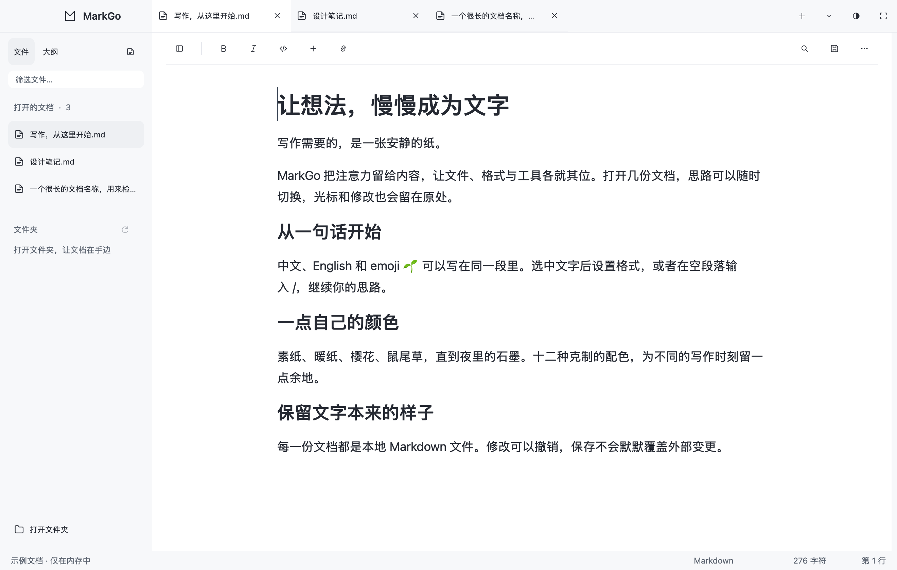

# MarkGo

[简体中文](README.zh-CN.md) · [Writing guide](docs/writing.md) · [Build instructions](docs/development/setup.md)

MarkGo is a free, open-source, local-first Markdown editor built with Rust and [GPUI Kit](https://github.com/longbridge/gpui-kit). Its GPU-rendered native interface has no WebView, Electron runtime or JavaScript UI.



*Actual application rendered in an isolated offscreen GPU window. Native platform acceptance is tracked separately.*

- Direct visual editing with headings, inline formatting, links, lists, tasks, quotes and fenced code, backed by ordinary Markdown source and undo.
- Independent tabs, folders, outline, recent files and guarded open/save/reload.
- Slash insertion and search/replace with case, whole-word, regex and selection scope.
- Local recovery drafts, explicit exit decisions and external-change protection.
- Twelve restrained themes, system appearance, prose font/size/width and Focus mode.
- Optional source and native reading views. Reading renders tables and local images; remote images are not fetched automatically.

Core writing needs no account or service. AI integration is deferred. Tables/images remain literal Markdown in direct editing; formulas remain text. Saving is manual; recovery copies are separate from documents. See the [writing guide](docs/writing.md).

## Build and run

Install rustup and native platform build tools. The repository pins Rust 1.99.1.

```sh
cargo run --locked
cargo run --locked -- --preview
make check
cargo build --locked --release
```

Preview uses in-memory samples and never attaches to real files, settings or recovery. See [platform setup and packaging](docs/development/setup.md). This source is under development; a successful build or headless test is not release certification.

[Design](DESIGN.md) · [Contributing](CONTRIBUTING.md) · [Roadmap](ROADMAP.md) · [Security](SECURITY.md)

Licensed under [Apache-2.0](LICENSE). See [NOTICE](NOTICE), [third-party notices](THIRD_PARTY_NOTICES.md) and [dependency/asset inventory](THIRD_PARTY.md). The MarkGo name and logo are not licensed under Apache-2.0.
