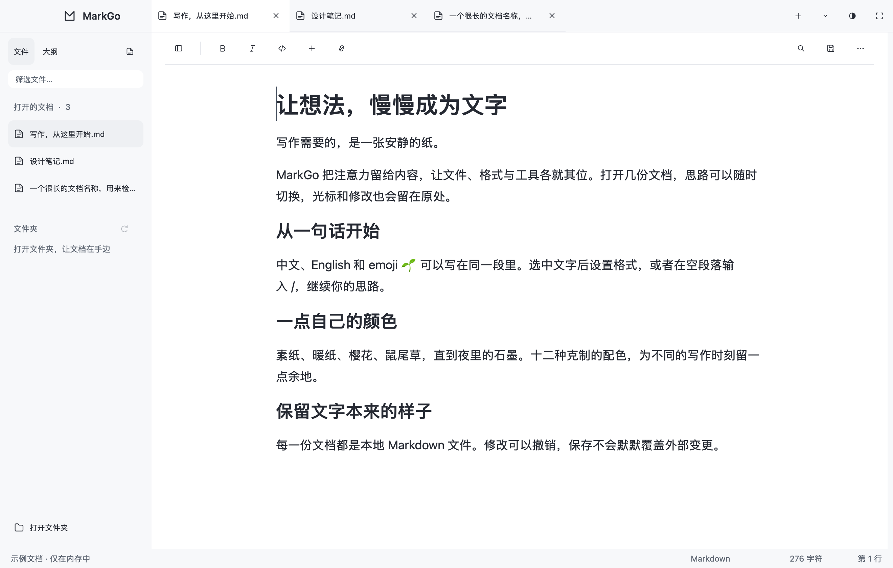

# MarkGo

[English](README.md) · [写作指南](docs/writing.md) · [构建说明](docs/development/setup.md)

MarkGo 是使用 Rust 与 [GPUI Kit](https://github.com/longbridge/gpui-kit) 构建的免费开源、本地优先 Markdown 编辑器。界面由 GPU 原生绘制，不依赖 WebView、Electron 或 JavaScript 界面层。



*图为实际应用的隔离无窗口 GPU 渲染；真实系统验收单独记录。*

- 直接编辑标题、行内格式、链接、列表、任务、引用和围栏代码，底层保留普通 Markdown 原文与撤销。
- 独立多文档标签、文件夹、大纲、最近文档，以及带保护的打开、保存和重新载入。
- `/` 格式菜单；支持大小写、全词、正则与选区范围的查找替换。
- 独立本地草稿恢复、明确的退出选择、外部修改检测。
- 十二套克制配色、跟随系统、正文字体/字号/宽度和专注模式。
- 可选源码与原生阅读视图。阅读支持表格和本地图片，不自动请求远程图片。

核心写作无需账号或服务，AI 能力暂缓。表格、图片在直接编辑中仍显示为 Markdown，公式保持文本。保存由用户主动触发，恢复副本独立于文档。具体边界见[写作指南](docs/writing.md)。

## 构建与运行

通过 rustup 安装 Rust，并准备平台原生编译工具。仓库固定 Rust 1.99.1。

```sh
cargo run --locked
cargo run --locked -- --preview
make check
cargo build --locked --release
```

预览使用内存示例，不读取真实文档、设置或草稿。平台依赖和打包见[开发说明](docs/development/setup.md)。当前源码仍在开发，编译和无窗口测试通过不等同于正式发布验收。

[设计规范](DESIGN.md) · [贡献指南](CONTRIBUTING.md) · [路线图](ROADMAP.md) · [安全政策](SECURITY.md)

采用 [Apache-2.0](LICENSE)。署名和第三方材料见 [NOTICE](NOTICE)、[第三方声明](THIRD_PARTY_NOTICES.md)与[依赖清单](THIRD_PARTY.md)。MarkGo 名称和 Logo 不以 Apache-2.0 授权。
