# Design system

## Direction

MarkGo should feel like opening a good notebook: a quiet page, clear type, and tools within reach. Its identity comes from proportion, spacing, an original line-drawn M, and consistent interactions. Keep the interface restrained: no decorative gradients, multicolored panels, or AI ornament.

The document is the visual center. Navigation supports writing; formatting appears when requested. A first launch starts with an empty editable document; subsequent launches resume the prior session. Guides are available through the document menu.

## Workbench and typography

A single 48 DIP self-drawn title bar contains a small document-menu wordmark, sidebar toggle, document title, five writing actions, and minimize/maximize/close controls. Find, Formatting, Read/Edit, Focus, and Appearance stay within reach. The 224 DIP sidebar holds Files/Outline, document filtering, open documents, the folder tree, and Open a folder. A quiet 30 DIP footer reports actual save state, optional operation messages, caret position, and word/character counts.

The native title bar and caption buttons are hidden with MyGo's `TitleBarHidden` and `HideWindowButtons`. The OS frame remains responsible for resize edges, rounded corners, and shadows; do not switch to a borderless `Frameless` window. Blank title-bar space drags the window and supports MyGo's native double-click behavior. The custom maximize target registers with `MaximizeButton` for Windows Snap integration. The close action calls `Window.Close`, preserving the existing unsaved-document guard. All three controls remain available in Focus mode.

The wordmark is 13 DIP with a 17 DIP symbol. The document name truncates before the writing tools and window controls; its tooltip exposes the path or full unsaved name. Files/Outline uses a short underline, and file selection uses a soft neutral surface. Open a folder stays at the bottom of the sidebar. Repeated file icons are omitted to give filenames room.

The centered page defaults to 720 DIP maximum width, 18 DIP system text, and 1.85 line height. The writing area has 48 DIP horizontal and 38 DIP vertical breathing room. The editor has no line-number gutter or active-line background. Writers can choose 14–24 DIP text, system or serif type, and 640/720/840 DIP page widths. At the 960 × 640 minimum window, the page shrinks to fit.

Read mode uses a 1.9× first heading, 1.35× second heading, and 1.12× third heading, with 600 weight and intentional paragraph spacing. Quotes, rules, code blocks, and tables share the neutral palette. Read mode is a separate native Markdown view; editable headings still use fixed editor line metrics. Do not show a reading screenshot as proof of directly editable rich typesetting.

## Theme tokens

| Token | Paper | Warm paper | Graphite |
| --- | --- | --- | --- |
| Page | #ffffff | #fbf8f2 | #191b20 |
| Sidebar | #f7f8fa | #f5f1e9 | #15171b |
| Hover | #eef0f3 | #eee8dd | #252830 |
| Pressed | #e2e5eb | #e4dccd | #303540 |
| Border | #e7e9ee | #e8e1d5 | #2c3038 |
| Ink | #252932 | #38342e | #e9ecf1 |
| Muted ink | #69717d | #736b60 | #a0a6b1 |

The accent is ink; selected text uses ink at 14% opacity. Semantic warnings remain recognizable and always include text. The system setting chooses Paper for light appearance and Graphite for dark appearance. Explicit themes ignore system changes.

The Appearance panel applies changes immediately to the whole client, including native-drawn menus, the editor, and reading view. Preferences are written atomically to the operating system's user configuration directory under MarkGo/appearance.json. No document contains appearance metadata. MARKGO_EPHEMERAL=1 bypasses loading and saving preferences.

## Icons and controls

The square application icon in resources/icon.png is configured in mygo.json and embedded for Window.SetIcon in both development and packaged builds. Keep at least 1024 × 1024 pixels so the same source can serve packaging and high-density displays. The interface icons in internal/app/icons.go are original vector drawings. The 24-unit control icons share 1.65-unit strokes, rounded joins, and rounded terminals; no emoji or font glyphs stand in for controls. Heading labels H1/H2 and textual search options retain their familiar notation.

Icon actions, formatting tools, and find inputs/buttons have 40 DIP hit targets. Window controls use 44 × 48 DIP targets; their glyphs are deliberately smaller. Hover and pressed states use the shared palette; icon backgrounds transition over 100 ms and writing-action buttons press to 0.96 scale. Appearance, Formatting, and Read/Edit indicate their active state. The window close button uses a red background only while hovered or pressed. Controls retain meaningful labels, tooltips, keyboard focus, and native widget behavior.

Use small, consistent radii: 6–8 DIP for controls and 12–14 DIP for floating panels. Sidebars are separated by surface tone. Subtle shadows are reserved for floating controls; the page has no enclosing card. Appearance and Formatting enter over 130 ms with a 4 DIP movement and fade, and leave over 90 ms with a 2 DIP movement. Transitions can be interrupted; MyGo's reduced-motion preference suppresses movement. Never animate the writing page.

## Interaction contracts

- Preserve source bytes, selection, undo history, and scroll when changing color themes.
- Typography changes may reflow text but preserve source and selection.
- Formatting preserves the selection until applying one undoable edit, then returns focus to writing.
- Appearance and Formatting are mutually exclusive. Escape closes the open panel without collapsing the writing selection; outside clicks dismiss it.
- File-list arrow, Home, and End navigation keeps focus in the list across document changes. Enter starts editing the selected document.
- Sidebar width moves over 180 ms with ease-out and can reverse from its current width. Its controls stop accepting input when closing. Keep the editor's identity stable and its source, selection, scroll and undo intact; never fade or scale the document.
- Files/Outline uses a 160 ms sliding indicator and a 120 ms content entrance. Outline rows align to the left and editing emphasizes the caret's current section. Read mode addresses reader anchors.
- File-row close targets occupy a reserved 40 DIP area and fade in over 100 ms on the current/hovered row (always reachable without hover on touch). Context actions address that file; menus use MyGo's self-drawn presentation throughout.
- A current-version save receives a quiet check and a two-second acknowledgment. New edits and failures override this feedback immediately; it never implies autosave or recovery.
- Recovery prompts sit above the document with a quiet icon, clear explanation and a nearby save action. A changed or unavailable original offers Save a copy. The footer distinguishes Draft backed up from Saved locally.
- Recent documents use a 560 DIP self-drawn dialog, searchable names and paths, 40 DIP actions, ellipsized long names and neutral hover transitions. Enter opens the first match; Escape returns to writing. Removing history never removes files.
- The exit dialog offers Keep drafts, Save all, Discard and Cancel. Keep drafts writes the final checkpoint before closing; failure defaults to staying open. Modal presentation protects the editor while preserving its selection and return focus.
- Follow system appearance has one full-row checkbox target.
- Cmd/Ctrl+, opens Appearance, Cmd/Ctrl+Backslash toggles the sidebar, and Cmd/Ctrl+Shift+F enters or exits Focus.
- New document always opens in editing mode, including from a reading view.
- In the isolated typesetting preview, lists share a hanging text inset and decimal numbering at every depth. The inset grows when a long ordinal needs room; checkboxes and bullets remain near their text. Continuations align with the item content.
- Task checkboxes use an 18 DIP drawing within a 40 DIP target, 100 ms neutral hover and 90 ms press feedback. Completed text uses muted ink. Targets never overlap adjacent items, even at 14 DIP type. Clicking preserves the writing caret and focus; Cmd/Ctrl+Enter toggles the caret's task. No task animation moves the page.
- Simple quotations use a 2 DIP neutral rule and one shared 40 DIP inset per level. Nested rules stay aligned through wrapped text. Return continues the quotation; an empty line exits one level without letting Markdown lazy continuation pull the next paragraph back in.
- Fenced code uses a quiet theme surface, 8 DIP corners, 16 DIP horizontal inset and monospace text at 90% of body size. Its 44 DIP header space holds language, Copy and Continue controls with 40 DIP targets. The source fences are hidden, including in empty blocks; no editable header or footer is inserted into the document.
- Code-header hover takes 100 ms; press uses a 90 ms transition to 0.96 scale. A local check acknowledges Copy for 1.5 seconds. The language popup follows the workbench's 130/90 ms enter/exit motion, validates in place, and returns writing focus on Apply, Cancel or Escape. Reduced motion suppresses movement. Language selection sets Markdown info and indentation behavior; it does not imply syntax highlighting.
- The sample-page list scrolls within its rail at the minimum window size. Revealing a newly selected sample does not prevent the user from scrolling the list afterward.
- Dirty markers and footer save state must reflect the buffer and actual saved version. Do not imply autosave.
- Parsing, file I/O, and preference writes stay off the native event loop. Unchanged typography reuses cached themes.

## Rendered examples

These are native headless renders, not desktop acceptance screenshots.

The interaction recording uses the actual application view and animation clock. It covers tab changes, interrupted sidebar motion, appearance and focus mode. It does not establish native GPU frame timing or IME behavior.

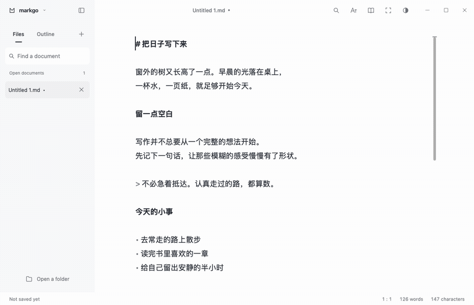

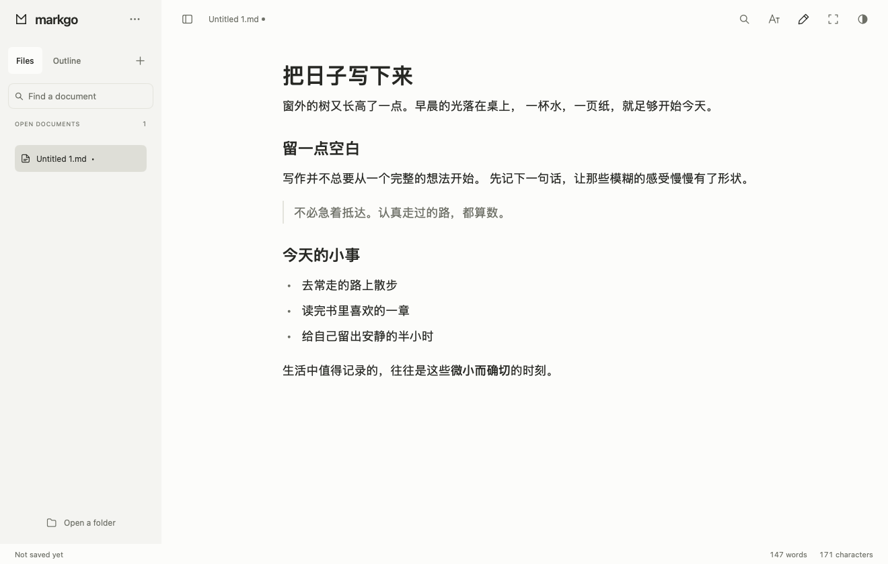

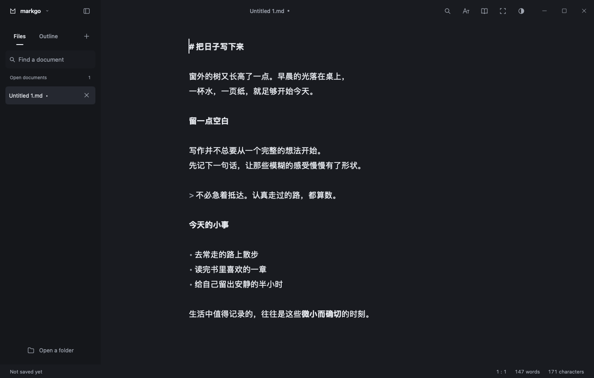

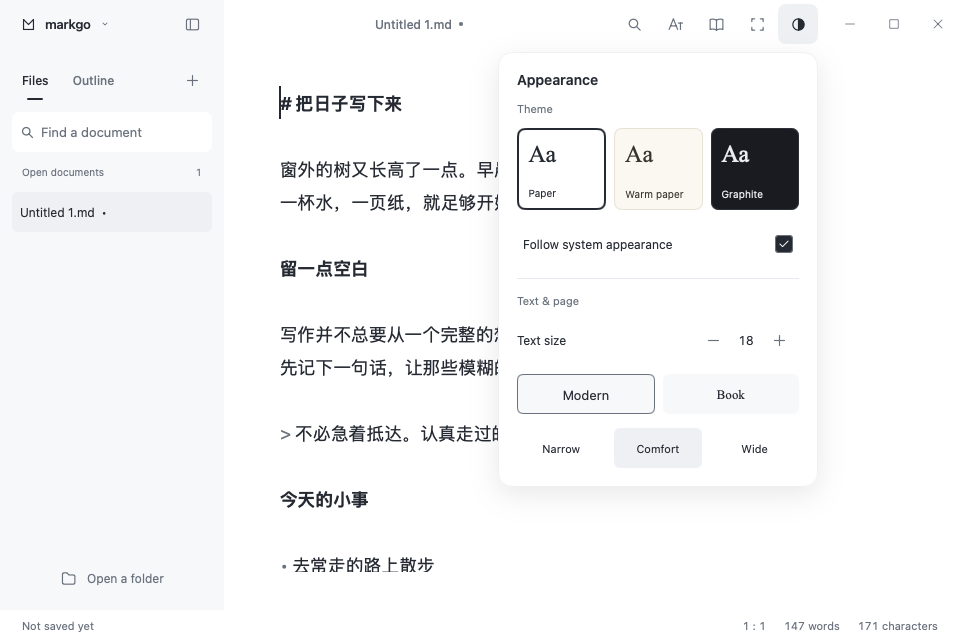

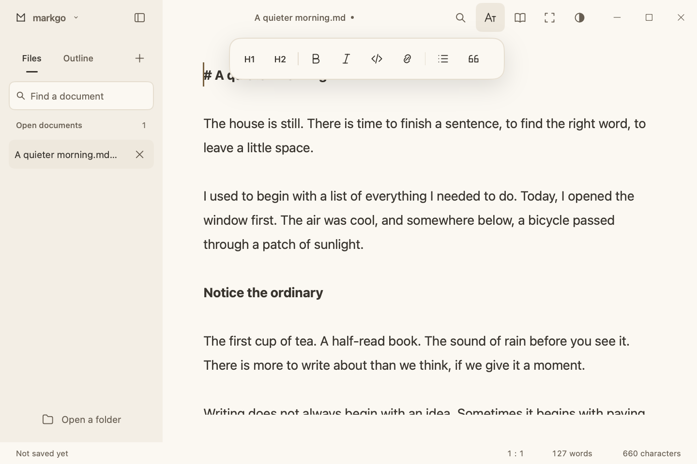

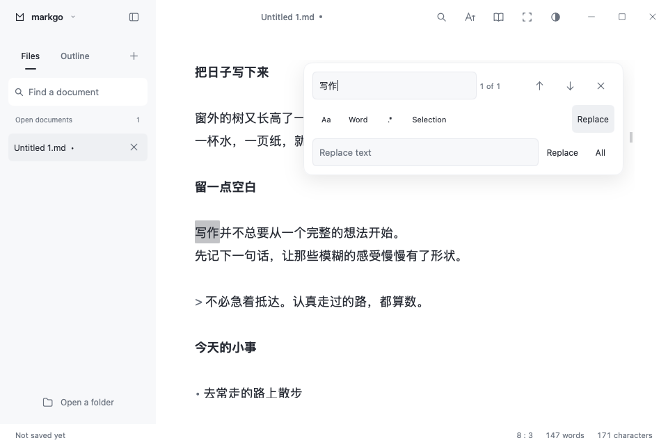

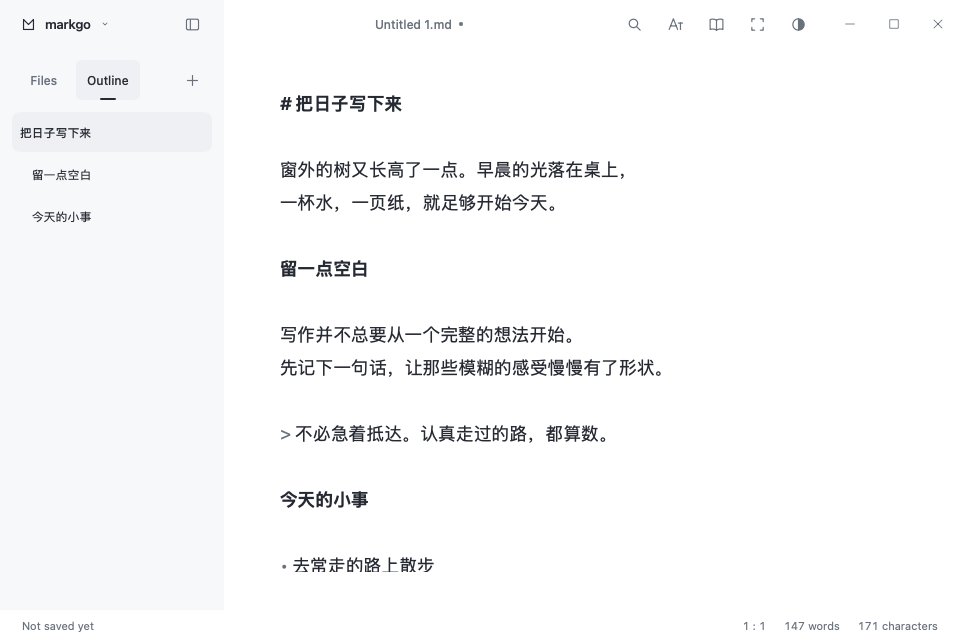

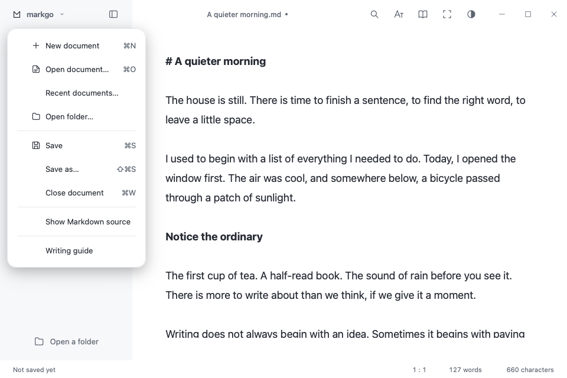

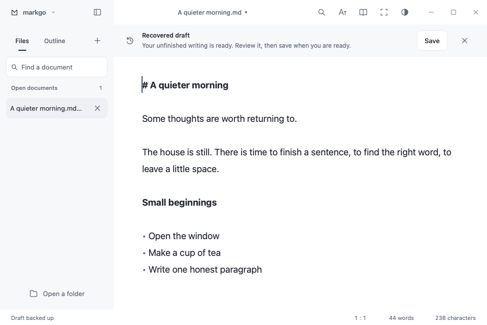

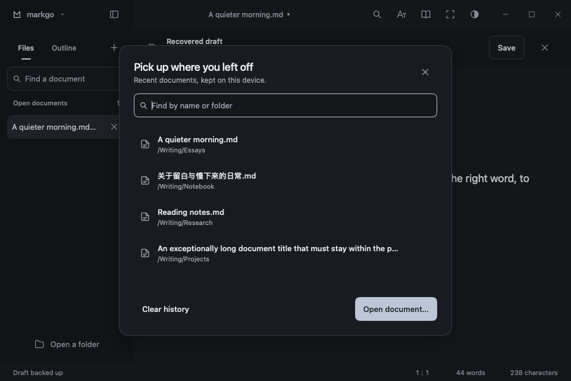

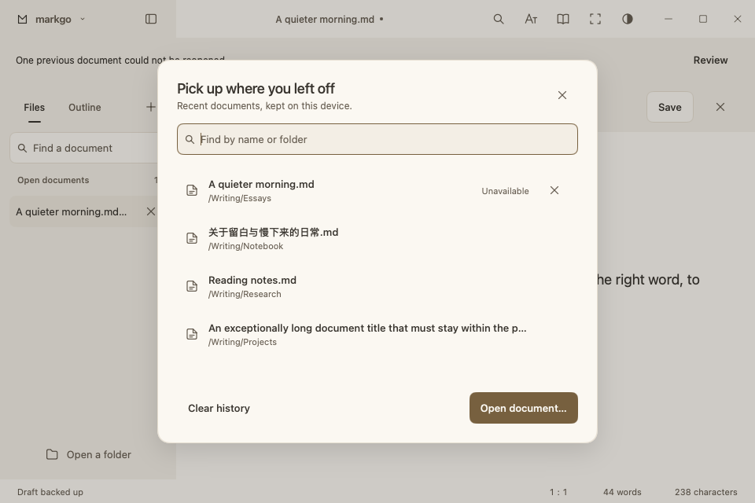

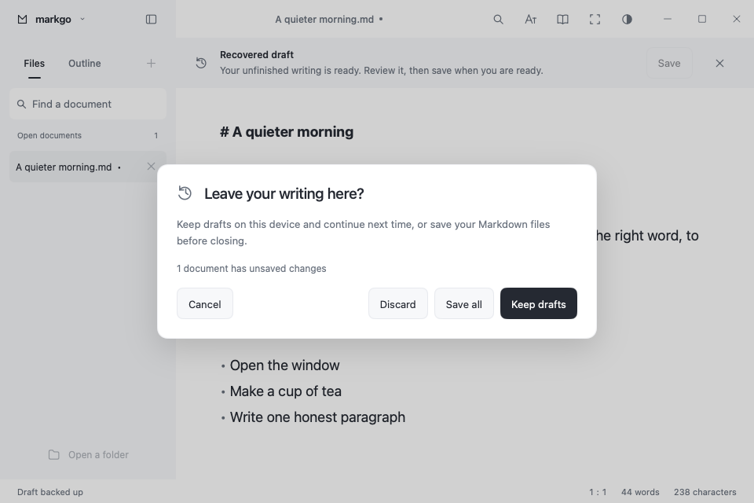

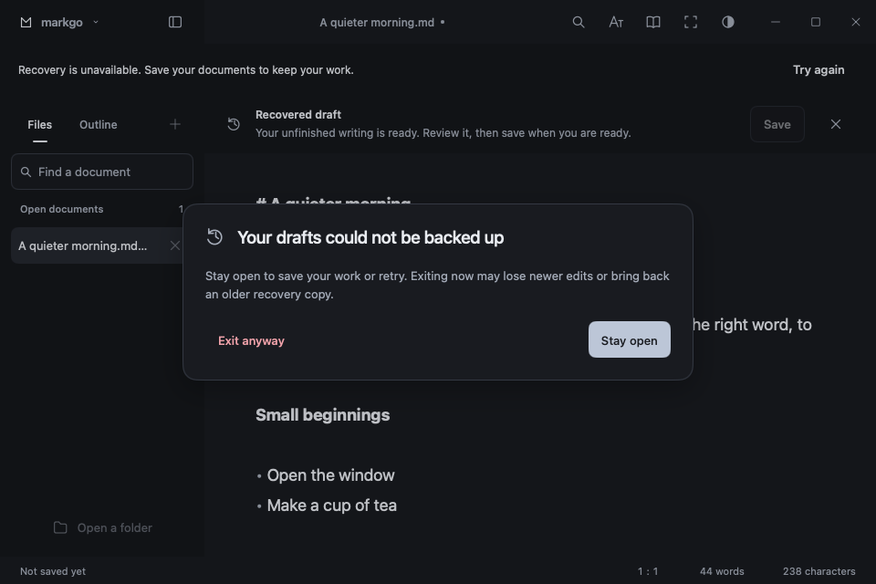

## Verification

Behavior tests cover theme and typography changes, system-following behavior, source/selection/scroll preservation, undo after dismissing a panel, preference round trips, long document names, caption actions, interrupted panels, reduced motion, and control bounds at the minimum size and 1×/1.5×/2× scale. Inspect both reading and editing, all three themes, open popovers, find/replace, and focus mode. Native font, IME, window, and screen-reader verification remains a separate platform check.
