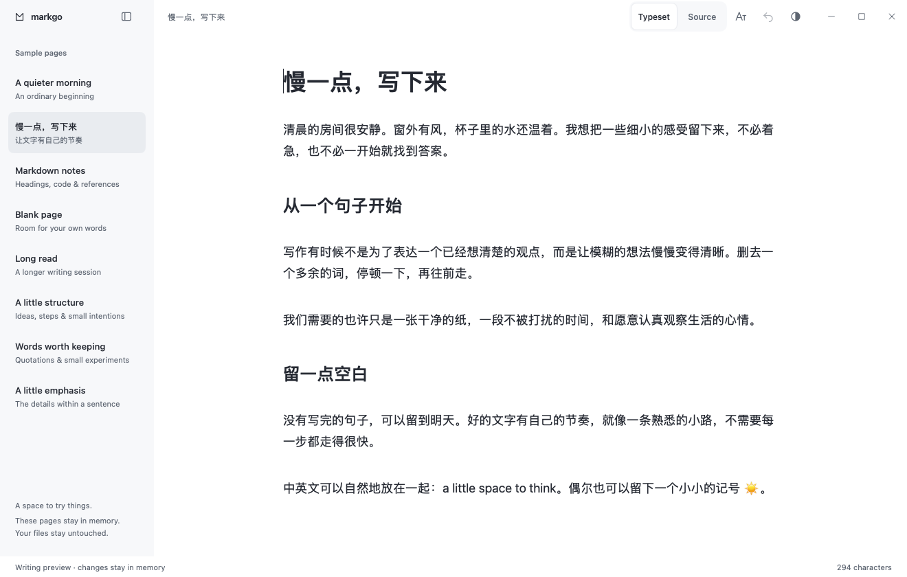
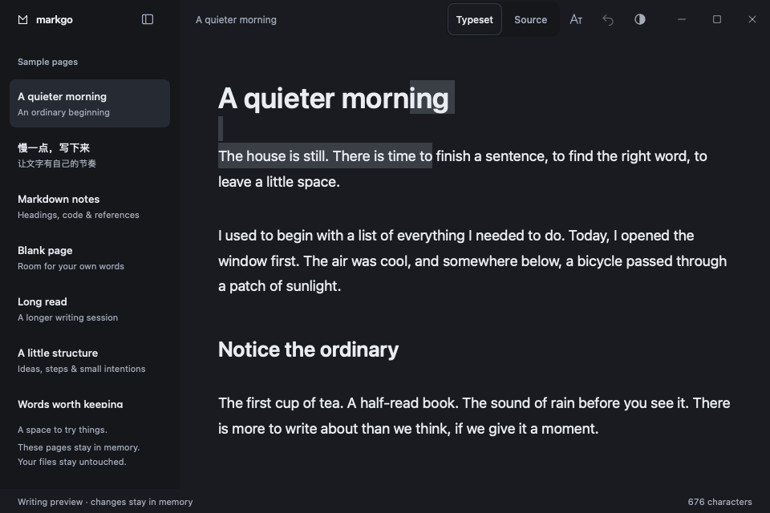
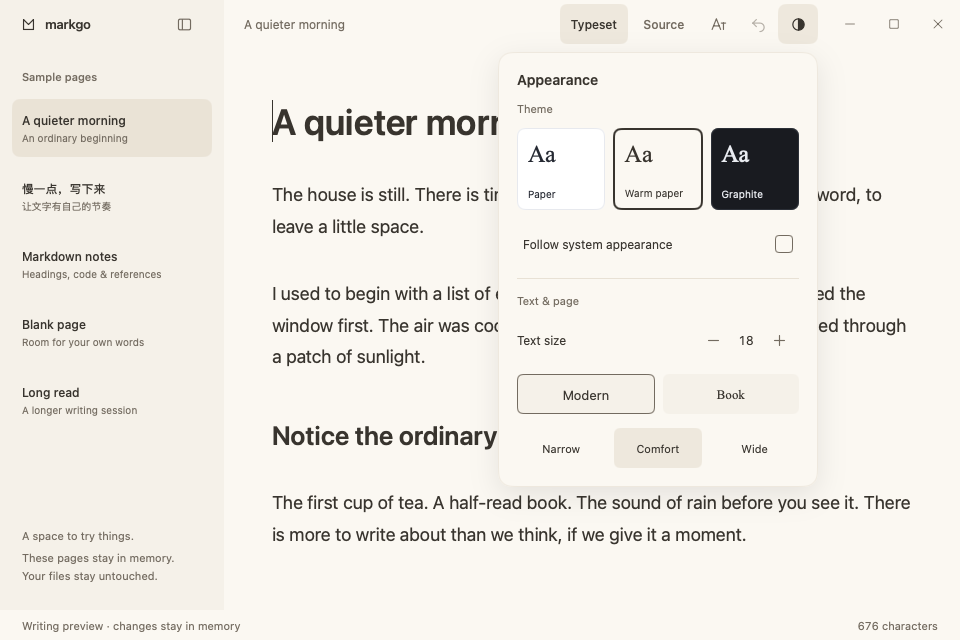
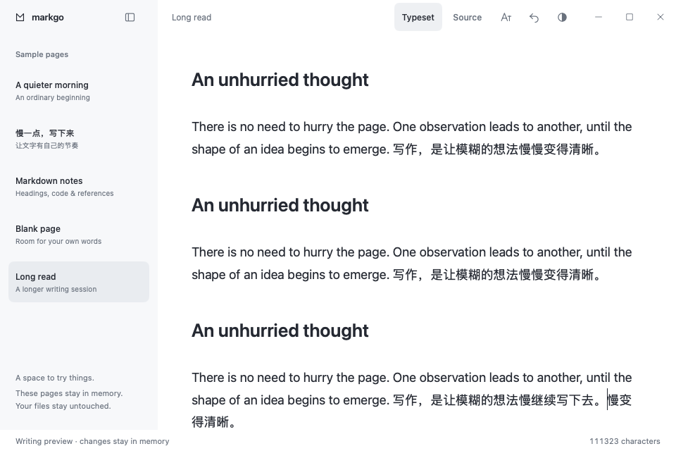

# Native typesetting checkpoint

This is an isolated, runnable editing experiment, not a 1.0 beta release or the default document editor. It opens built-in samples only. Changes stay in memory and closing the preview discards them. It has no file associations, open/save callbacks, recovery store, appearance store or single-instance handoff.

## Try it

```sh
go run ./cmd/markgo-preview
go tool mygo build -skip-dmg ./cmd/markgo-preview
go tool mygo build -platform windows/amd64 -skip-installer ./cmd/markgo-preview
```

The standalone application is **MarkGo Writing Preview**, under `build/typesetting-preview/`. The ordinary MarkGo executable also accepts `--typesetting-preview` as its first argument, before any real workspace initialization. Normal launches retain the existing editor.

Edit the English or Chinese sample directly. Drag from a heading into a paragraph, replace the selection, undo, switch to Source, type, switch back, and undo again. The Blank page and Long read samples exercise the same editor. `Cmd/Ctrl+Shift+M` switches views; `Cmd/Ctrl+0/1/2/3` applies a paragraph or heading. Appearance and sample-sidebar controls retain the writing selection. Switching views or pages cancels unfinished composition and restores the original selection with an explanatory notice.

## Changes in this checkpoint

| Before | After |
| --- | --- |
| Editable source uses one font size; larger headings are available in the separate reader | The preview directly edits headings and paragraphs with native variable-size text layout, a 720 DIP page, 18 DIP body text and 1.75 line height |
| Reading and source have different roles | Typeset and Source edit the same canonical `editor.Buffer`; view switches transfer the primary selection and retain history |
| No runnable source-preserving rich-text adapter | A rune-to-source-byte map hides top-level ATX prefixes and applies precise edits without Markdown serialization |
| A straightforward rich-text round trip rewrites unsupported syntax | Untouched code languages, tables, reference definitions, front matter and line-ending metadata stay intact; unsupported syntax remains visible |
| Rich text and source would normally have separate undo stacks | Native menu commands, typing bursts, paste and composition commits route to source history; one input-method commit is one step |
| Keyboard-event simulation alone misses direct desktop text-service calls | An application-owned `TextInputClient` handles direct UTF-16 replacements, preedit, cancellation, and unmark-before-commit ordering; richtext supplies shaped caret geometry |
| The ordinary application is the only executable | A separate preview entry and bundle identifier allow sample-only inspection without touching the real workspace |
| Existing workbench appearance and motion | The preview reuses Paper, Warm paper, Graphite, custom titlebar, reversible sidebar motion, quiet hover feedback and small popover transitions; no page entrance motion |
| First prototype screenshots had tight body lines and an initial zero character count | Corrected line height and initialized statistics, then captured the rendered states again |
| Every input rebuilt a per-rune source map, reparsed all Markdown and reset the rich-text document | Incremental parsing and line records update the affected source region; precise display replacements retain unchanged paragraph layouts |
| Every source version invalidated all paragraph styles | Ordinary typing retains style caches; heading-level and paragraph-count changes still invalidate them |
| Preedit attributes were discarded as a side effect of resetting the document | Commit and cancellation explicitly clear preedit underlines, including unchanged-text composition |

## Engineering decision

Continue the source-preserving native richtext adapter experiment. Keep it out of the real document lifecycle until the remaining gates pass.

| Approach | Evidence and tradeoff |
| --- | --- |
| Extend `ui/editor` block layout | The pinned editor has one font and line-height model. Variable-height blocks would require changes throughout wrapping, hit testing, scrolling and input geometry in the dependency. Existing source behavior remains useful as the canonical buffer and fallback view. |
| Serialize `richtext.ParseMarkdown` | Rejected: the earlier probe lost code language, rewrote references, and converted tables/front matter. No-op loading must not rewrite a file. |
| Project source into native richtext | Selected for this checkpoint. Reuses shaping, continuous pointer selection, wrapping and caret layout while keeping source authoritative. Requires explicit source maps and input/history adapters; these are exercised here, not assumed. |

`internal/mdeditor/typesetting*.go` implements the adapter. `Document` is disposable display state, including staged preedit. The source buffer changes only when an edit is committed. `FromSource` patches display text without editing source or clearing source history. Header commands, native Edit-menu commands and clipboard paste use that same history. Paste reads plain text rather than importing HTML/RTF attributes. Unsupported rich-format commands show feedback rather than creating formatting that cannot be saved in Markdown.

The projection retains the pinned parser's incremental document and a compact source/view record per physical line. Unchanged lines retain their rune counts. Every update reconciles top-level block kinds, since a fence or front-matter edit can change distant headings. UTF-8 replacements stop at rune boundaries. Ordinary text edits do not invalidate all paragraph styles or replace the whole rich-text document. This is not constant-time editing: source/display strings, downstream offsets, block reconciliation and some native text-service queries still involve document-wide work.

Native input methods can call `TextInputClient` without `ObserveInput`. The adapter therefore owns that client rather than relying on keyboard observations to identify composition. Preedit replaces display text only. Cancellation restores the selection and source; confirmation commits once. An immediate final replacement after Unmark replaces that exact commit only if the source version and native range still match. Typing bursts similarly merge only the adapter's own latest version at the same caret; navigation, commands and IME break the burst.

## Evidence

Behavior tests cover forward and reversed cross-block selections, pointer drag, deletion/joining, Enter at heading start/middle/end, select-all deletion, emoji and CJK offsets, plain-text paste from a mixed HTML/text clipboard, native menu undo/redo, shared source-mode history, direct native-client calls, composition cancellation and unmark/commit ordering. Unchanged replacement tests guard against accidentally undoing earlier writing. Long-document tests use more than 100,000 Unicode characters and verify typing/undo at the start, middle and end, including source preservation and caret stability. Incremental projection tests compare text, line records and source/view offsets with a fresh parse after edits and undo. A 20-second local fuzz run completed 182,604 cases without a mismatch, including fences, front matter, HTML, nested blocks and Unicode replacements.

Rendered evidence comes from the actual Go view through `ui.NewTester`, not a browser or design mockup. The screenshot matrix has **42 states**: 14 scenes × three palettes, including writing, Chinese, selection, source, appearance, paragraph menu, empty, notice, sidebar hidden, simulated composition, literal syntax, long document, editing in the middle of a long document, and 24 DIP book typography. Writing/Chinese use 1320×840; the other scenes use 960×640. All states were recaptured and inspected after the incremental update. The six previously committed reference screenshots remain pixel-identical.









On an Apple M2 Max, Go 1.27.4, CGO disabled, fixed-workload benchmarks compare the merged baseline `b8f6526` with the incremental implementation. Each result below is the median of three runs of 200 operations; MB means decimal megabytes allocated per operation. An edit cycle inserts `中🙂` and undoes it, restoring exactly the same fixture each time. The complete preview benchmark includes the workbench and word-count updates.

| Workload | Before time / allocation | After time / allocation |
| --- | --- | --- |
| Editor, continuous input, 100,000+ characters | 7.43 ms / 16.15 MB | 3.37 ms / 1.31 MB |
| Editor, start edit + undo | 10.18 ms / 33.70 MB | 1.59 ms / 5.43 MB |
| Editor, middle edit + undo | 14.47 ms / 33.90 MB | 5.15 ms / 4.43 MB |
| Editor, end edit + undo | 17.97 ms / 33.82 MB | 7.88 ms / 2.87 MB |
| Complete preview, middle edit + undo, 111,317 characters | 15.95 ms / 21.93 MB | 9.73 ms / 4.93 MB |

Raw [before](benchmarks/typesetting-2026-11-13-before.txt) and [after](benchmarks/typesetting-2026-11-13-after.txt) output is retained for comparison. These are CPU/headless averages, not desktop input latency, p95, GPU frame time or a native performance acceptance result. They also do not establish bounded live-heap use or long single-paragraph performance.

Local `go test ./...`, module consistency, Go vet, MyGo vet for both entries, staticcheck and macOS/Windows preview packaging are checked for this checkpoint. The local `make` shim is blocked by an unaccepted Xcode license, so its component checks are run individually; CI runs the actual Make target and race detector.

**Native acceptance is still pending.** The computer-use tool did not grant access to the standalone preview application. No real desktop screenshot, OS candidate-window check, Windows drag/Snap/DPI check or OS clipboard acceptance is claimed. Calling the native client directly in tests verifies the adapter contract, not the behavior of an installed input method.

## Limits and next gates

- Only top-level ATX heading prefixes receive structured presentation. Optional closing heading markers remain literal. Setext headings, inline syntax, lists, quotes, code, front matter, images and tables remain editable Markdown text.
- Physical source lines remain separate display paragraphs; soft-line-break paragraph fusion and blank-line spacing need a deliberate model before expanding block support.
- Incremental projection and retained layout now reduce ordinary typing costs. Full-string snapshots, offset updates, native text-service range queries, long single-paragraph behavior and sustained live-heap use still need profiling. Precise paragraph anchoring across mode switches, native text-service hit testing, multi-line preedit and actual desktop input latency remain integration gates.
- Current history is in memory; this preview does not save or recover edits. The production editor's recovery implementation is separate and unchanged.
- Next: source-preserving list continuation, indentation and exit behavior, followed by quotes and code. Native Windows/macOS IME and selection acceptance remains required before integration with ordinary documents. Images, tables and export follow the [beta delivery plan](beta-delivery.md). Do not promote this adapter to ordinary files just because the sample looks finished.
