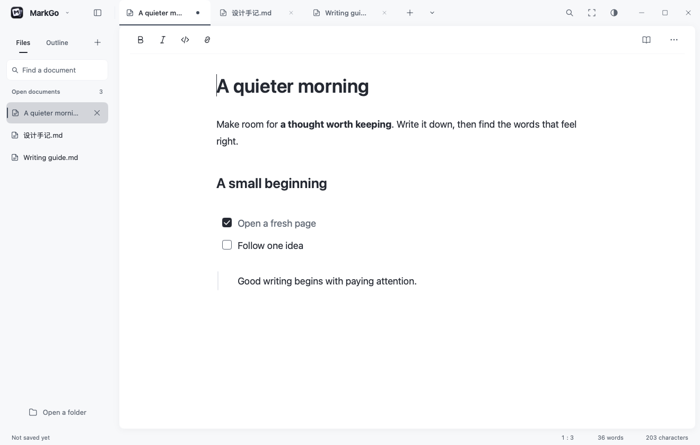
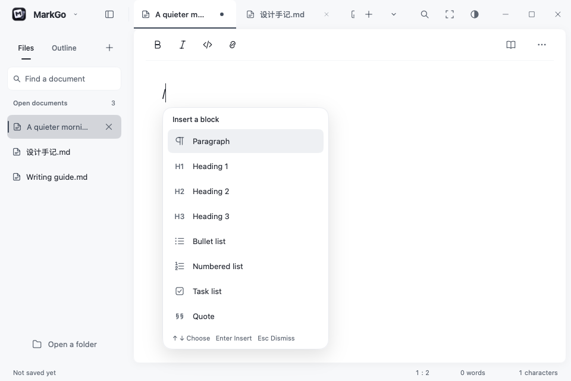
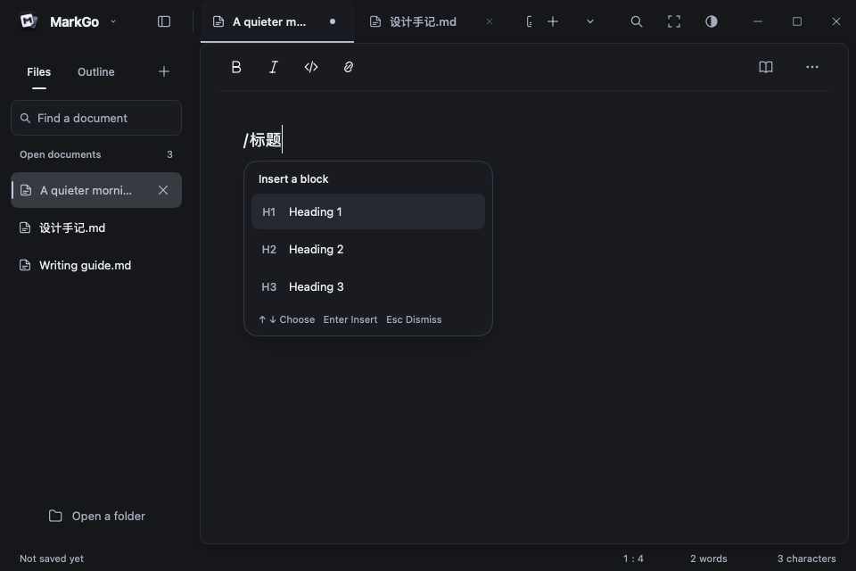
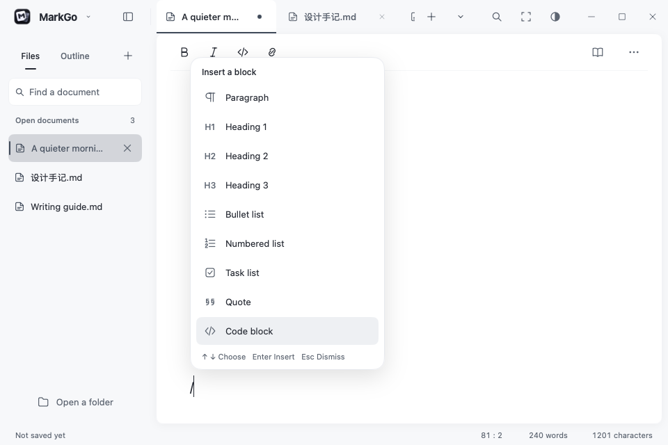
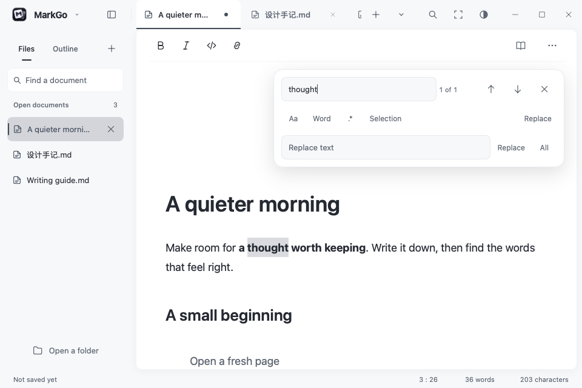

# Visual writing and slash insertion

This checkpoint integrates the source-preserving Typesetter into ordinary documents. It does not certify a 1.0 beta release. There is no WebView, AI integration or rich-text Markdown serialization.

## Behavior changes

| Before | After |
| --- | --- |
| The ordinary writer hid syntax using fixed source-editor line metrics; editable typesetting was sample-only | Real files default to editable native headings, lists/tasks, simple quotes, fenced code and supported inline spans; the canonical Markdown buffer still owns text and history |
| Write/Read occupied a permanent toolbar segment | View options and Document menu → View offer Visual editing, Markdown source and optional Reading view; the existing inline tools and block-format entry remain available |
| Inserting a block required formatting controls or remembered syntax | A focused empty-paragraph hint introduces `/`; nine implemented commands support Chinese/English filtering, arrows, Enter/Tab, pointer selection and Escape |
| A command menu could jump as the query grew, cover the caret on upward placement or clip part of a label | The horizontal anchor stays fixed, the full caret rectangle determines upward placement, and the viewport uses whole 40 DIP rows with native vector icons and shared theme/motion |
| Removing a slash query and adding syntax could become separate edits | Query deletion and the existing block command are one source transaction; Undo restores the complete query; dismissal retains it |
| Search belonged to the source editor | Visual search reserves space above the page, keeps the current visible match highlighted while the field is focused, and preserves case/whole-word/regex/selection options and one-step replace-all |
| A search scope could shrink at replacement edges or drift after document edits | UTF-8 anchors retain edge replacements through undo; changes crossing an ambiguous boundary stop scoped replacement and ask for a fresh passage selection |
| Rebuilding rich views could discard private viewport state | Previously visited documents keep hidden keyed views; inactive views skip projection work, overlays, painting, input and accessibility, and closing a document releases its Typesetter |
| Native focus release could unmark an unfinished candidate before navigation ran | Tabs preserve writing focus on pointer-down; the file list and mode/document menus cancel preedit before release. Save/recovery capture committed source without cancelling live composition |
| Main file tools used source-only selections | Formatting, outline, search, tab switches and mode switches map selections into the same source-preserving editor; closing the final clean tab starts a fresh focused document |
| Guides described caret-revealed marks and three themes | User guides, embedded examples, architecture, design rules and release gates describe the integrated editor, twelve themes, secondary views and remaining limits |

## Evidence

The full Go suite and the direct equivalents of `make check` passed: formatting, module tidy diff, Go vet, both MyGo lifetime checks, staticcheck and coverage tests. The host's `make` exits 69 because the Xcode license is unaccepted; that setting was not changed.

New behavior tests cover all nine slash commands, Chinese filtering, pointer cancellation, literal-text dismissal, code/metadata/paste exclusions, direct text-service composition, source undo, real temporary-file CRLF saving/reopening, reference syntax, recovery, actual rich viewport geometry, independent tab histories, final-tab closure, regex replacement, search scope and highlight geometry. A saved snapshot is compared with actual disk bytes. All fixtures use temporary files or in-memory documents.

The screenshot run produced **392 actual Go-view renders**: 39 integrated writing states, 156 theme/gallery states, 48 workbench states, 8 scale states and 141 isolated-typesetting states. Inspection covers the new flows in Paper, Sakura and Graphite, the twelve-theme writing/formatting/appearance boards, and full-size search, blank, menu, code and link details. Automated pixel checks confirm the toolbar divider and outer gutter in 108 unobscured renders. Geometry tests cover 960 × 640 at 1×/1.5×/2×, popup flipping, complete rows, press cancellation and a search panel that cannot cover the current match. These are headless rendering and behavior results, not native desktop acceptance.











Reproduce:

```sh
CGO_ENABLED=0 go test ./... -count=1
MARKGO_SCREENSHOT_DIR="$PWD/build/visual-writing-review/rendered" CGO_ENABLED=0 go test ./internal/app -run '^Test(ProductPolishScreenshots|ProductScaleScreenshots|WorkbenchTabsScreenshots|VisualWritingScreenshots|TypesettingScreenshots)$' -count=1
go tool mygo build -skip-dmg
go tool mygo build -skip-dmg ./cmd/markgo-preview
```

## Native and release limits

The Roundtable desktop tool was asked to screenshot the allowed `dev.markgo.writing-preview` application. It returned “请在主机上打开指定应用，并保留一个运行实例。” The tool cannot launch it. No shell or alternate desktop tool was used to bypass that constraint, and no current native screenshot, installed-IME or OS clipboard acceptance is claimed.

Images, tables, front matter and unsupported complex Markdown remain literal source in visual editing; the optional reader displays local images and tables. Exact rich/reader pixel scroll and undo history are not restored across application relaunches. Visual editing has one continuous selection; multiple carets remain in source mode. The sample-only preview still has no real file or recovery stores. Native platform tests, sustained large-document latency/memory checks and the other [beta gates](beta-delivery.md) remain outstanding.
